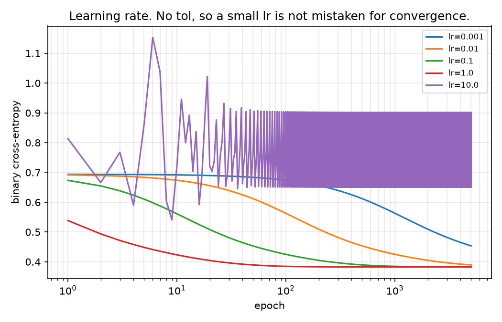
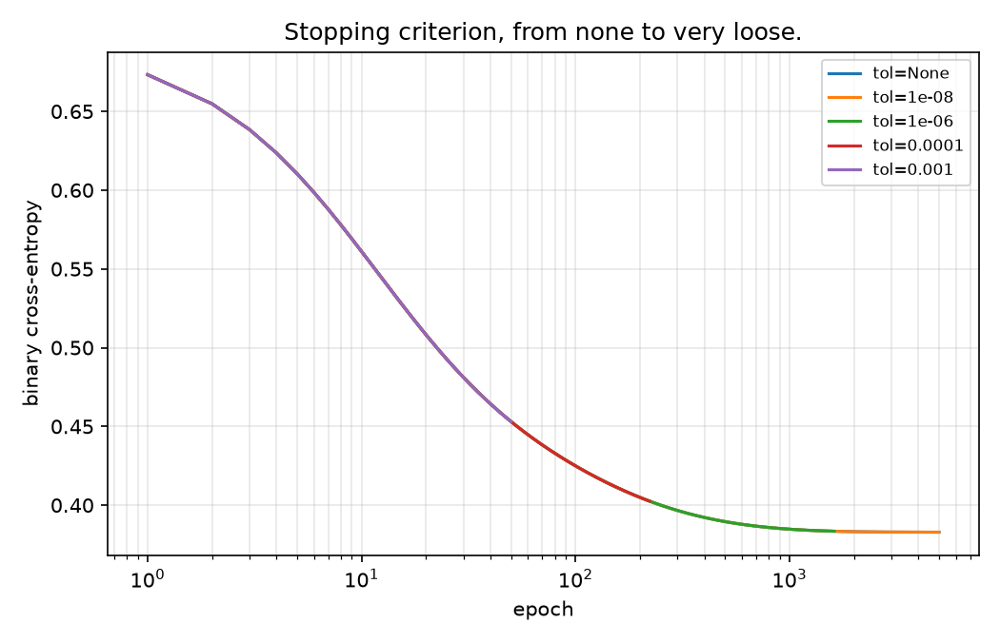
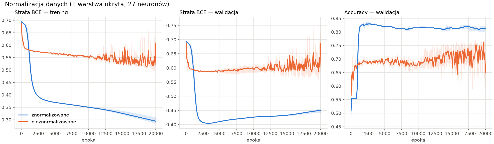
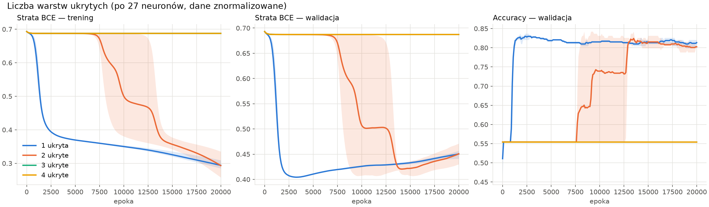
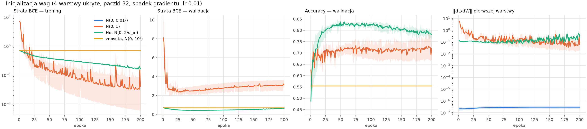
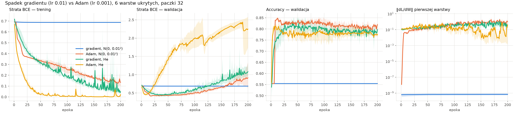
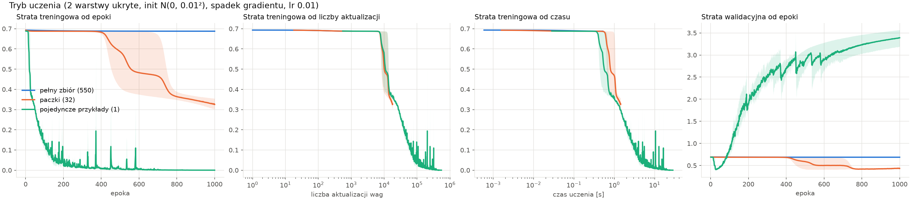

# Neural networks from scratch: convergence study on UCI Heart Disease

Logistic regression and a multilayer perceptron implemented in NumPy, with backpropagation and
Adam written by hand, and studied on the UCI Heart Disease data. The question: which choices of
learning rate, initialization, architecture and optimizer actually decide whether training
converges?

## Results

Test set, 184 patients, the same 60/20/20 split for every model. The MLP rows are the mean over
three seeds.

| model | accuracy | ROC AUC |
|---|---|---|
| Logistic regression (this repo) | 0.837 | 0.933 |
| scikit-learn `LogisticRegression` | 0.832 | 0.934 |
| scikit-learn `RandomForest` | 0.826 | 0.909 |
| MLP, 1 hidden layer of 27, full batch, 20000 epochs | 0.846 ± 0.007 | not measured |
| MLP, 2 hidden layers of 27, batch 32, 1000 epochs | 0.842 | 0.921 |

## Key findings

**Logistic regression**

- The loss is convex, so a learning rate that is too small only slows training down. Too large a
  one (lr = 10 here) makes the loss oscillate regardless of the number of epochs.
  
- A loose stopping tolerance ends training before convergence, and the result can look converged.
  

**MLP**

- One hidden layer already matches logistic regression. A wider layer only improves the fit on
  the training set, and without feature scaling test accuracy falls from 0.846 to 0.652.
  
- With weights from N(0, 0.01²), two hidden layers start learning only after 7500 to 13000
  epochs, and three or more do not learn at all: the model predicts a constant.
  
- Of the tested initializations, only He lets a deep network learn with plain gradient descent
  from the first epoch.
  
- Adam escapes the plateau on which plain gradient descent stays. With He initialization it also
  reduces the loss faster, and overfits faster.
  
- Smaller batches shorten the plateau measured in epochs, but not when it is measured in updates.
  

## What is implemented

- `LogisticReg`: a scikit-learn compatible classifier with gradient descent, several
  initializations and a tolerance-based stopping rule.
- `MLP`: ReLU hidden layers, sigmoid output, binary cross-entropy, backpropagation, normal and He
  initialization.
- `SGD` and `Adam` optimizers; full-batch, mini-batch and single-example training.
- A finite-difference gradient check (`python -m heartnn.gradcheck`).
- Cleaning and preprocessing fitted on the training split only.
- Exploratory data analysis in `notebooks/01_eda.ipynb`.

## Experiment tracking with MLflow

All studies are logged to a local SQLite store, in two experiments:

- `logreg-from-scratch`: one run per variant.
- `mlp-from-scratch`: one parent run per configuration, with the mean and std over seeds and the
  study figures, and a nested run per seed with the full learning curves. Each run has a `study`
  tag, so one study can be selected with the filter `tags.study = 'depth'`.

```bash
mlflow ui --backend-store-uri sqlite:///mlflow.db
```

The MLP studies also write their summaries to `reports/figures/results.md` and `results2.json`.

## Reproduce

```bash
python -m venv .venv && source .venv/bin/activate
pip install -e ".[dev]"
pytest
python -m heartnn.train             # logistic regression, a single run
python -m heartnn.experiments       # logistic regression studies from configs/experiments.yaml
python -m heartnn.mlp_architecture  # MLP: width, normalization, depth
python -m heartnn.mlp_optimization  # MLP: batch size, initialization, Adam
```

The written reports (in Polish) are `reports/report.tex` and `reports/report_mlp.tex`.

## Data

[UCI Heart Disease](https://archive.ics.uci.edu/dataset/45/heart+disease) (Janosi, Steinbrunn,
Pfisterer and Detrano, 1988; CC BY 4.0). The four `processed.*.data` files are combined, giving
918 patients after removing duplicates. The target is binarized as `num > 0`.

## Limitations

- One stratified split with 184 test patients, so small differences between models are noise.
- Test metrics are reported for every configuration, so they describe the studies rather than
  give an untouched estimate for one selected model.
- Three seeds show the spread between runs, but are too few for a formal comparison.
- The four centres differ a lot in how much data is missing, and this is handled only by
  imputation with missing-value indicators.

## Project layout

```
configs/    logistic regression experiment definitions
data/       UCI Heart Disease, processed files
notebooks/  exploratory analysis
reports/    written reports, figures and MLP result summaries
src/heartnn/
  models/   logistic regression, MLP, optimizers
  ...       data, preprocessing, training, experiments, gradient check
tests/      unit tests
```
