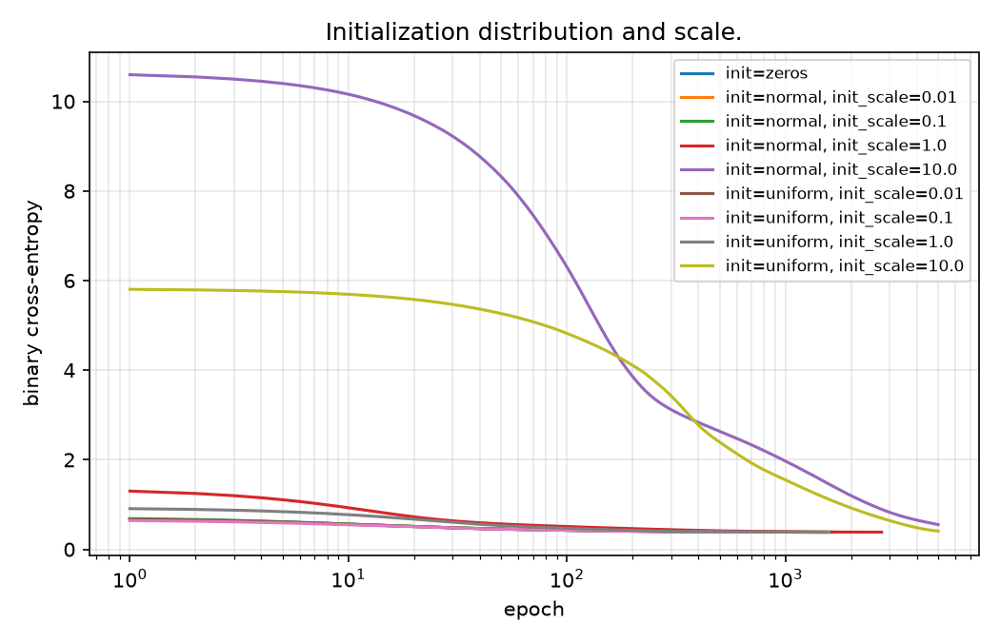

# Neural networks from scratch: convergence study on UCI Heart Disease

Logistic regression implemented in NumPy and trained with gradient descent on the UCI Heart
Disease data. The question: does a bad choice of learning rate, initialization or stopping
criterion prevent convergence, or does it only make training longer?

## Results

Test set, 184 patients, the same 60/20/20 split for every model.

| model | F1 | precision | recall | accuracy | ROC AUC |
|---|---|---|---|---|---|
| Logistic regression (this repo) | 0.857 | 0.833 | 0.882 | 0.837 | 0.933 |
| scikit-learn `LogisticRegression` | 0.852 | 0.832 | 0.873 | 0.832 | 0.934 |
| scikit-learn `RandomForest` | 0.848 | 0.824 | 0.873 | 0.826 | 0.909 |

## Key findings

- The loss is convex, so a learning rate that is too small only slows training down. Too large a
  one (lr = 10 here) makes the loss oscillate regardless of the number of epochs.
  
- A large initialization scale lengthens training, but the model still reaches the same minimum.
  
- A loose stopping tolerance ends training before convergence, and the result can look converged.
  

## What is implemented

- `LogisticReg`: a scikit-learn compatible classifier with gradient descent, several
  initializations and a tolerance-based stopping rule.
- Cleaning and preprocessing fitted on the training split only.
- Exploratory data analysis in `notebooks/01_eda.ipynb`.

## Experiment tracking with MLflow

Each variant is one run in a local SQLite store:

```bash
mlflow ui --backend-store-uri sqlite:///mlflow.db
```

## Reproduce

```bash
python -m venv .venv && source .venv/bin/activate
pip install -e ".[dev]"
pytest
python -m heartnn.train         # a single run
python -m heartnn.experiments   # all studies from configs/experiments.yaml
```

The written report (in Polish) is in `reports/report.tex`.

## Data

[UCI Heart Disease](https://archive.ics.uci.edu/dataset/45/heart+disease) (Janosi, Steinbrunn,
Pfisterer and Detrano, 1988; CC BY 4.0). The four `processed.*.data` files are combined, giving
918 patients after removing duplicates. The target is binarized as `num > 0`.

## Limitations

- One stratified split with 184 test patients, so small differences between models are noise.
- The four centres differ a lot in how much data is missing, and this is handled only by
  imputation with missing-value indicators.

## Project layout

```
configs/    experiment definitions
data/       UCI Heart Disease, processed files
notebooks/  exploratory analysis
reports/    written report and figures
src/heartnn/  package: data, preprocessing, models, training, experiments
tests/      unit tests
```
